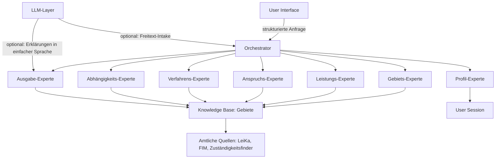
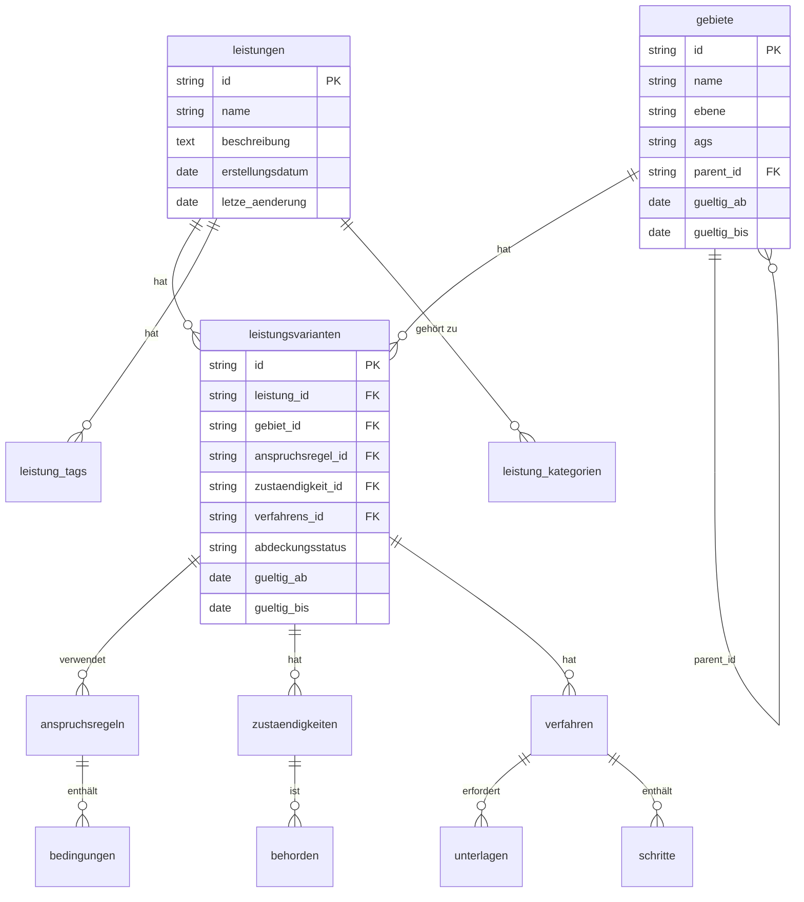

# BürgerAi – Architektur-Dokument

**Stand:** 21.10.2026  
**Version:** 1.0 (Entwurf)  
**Ziel:** Deterministische, nachvollziehbare und skalierbare Lösung für die Identifikation von Ansprüchen auf öffentliche Leistungen in Deutschland.

---

## 📌 Inhaltsverzeichnis

1. [Ziele und Grundprinzipien](#1-ziele-und-grundprinzipien)
2. [Systemübersicht](#2-systemübersicht)
3. [Schichtenmodell](#3-schichtenmodell)
4. [Experten-Architektur](#4-experten-architektur)
5. [Datenmodell](#5-datenmodell)
6. [Workflow-Beispiele](#6-workflow-beispiele)
7. [Technologie-Stack](#7-technologie-stack)
8. [Nicht-funktionale Anforderungen](#8-nicht-funktionale-anforderungen)
9. [Offene Entscheidungen](#9-offene-entscheidungen)
10. [Nächste Schritte](#10-nächste-schritte)

---

## 1. Ziele und Grundprinzipien

### 1.1 Kernziele
- **Deterministische Logik**: Keine LLM-basierten Entscheidungen für Anspruchsprüfung oder Zuständigkeit.
- **Regionale Variabilität**: Unterstützung der drei Ebenen (Bund, Land, Kommune) mit Vererbung.
- **Nachvollziehbarkeit**: Jede Ausgabe ist mit Quellen und Gültigkeitszeiträumen verknüpft.
- **Skalierbarkeit**: Priorisierte Abdeckung (Bund > Land > Kommune) für 11.000+ Gemeinden.
- **Datenschutz**: DSGVO-konform, keine Speicherung sensibler Daten, EU-Hosting.

### 1.2 Grundprinzipien
| Prinzip | Beschreibung | Umsetzung |
|---------|--------------|-----------|
| **Regelbasiert** | Alle Experten arbeiten mit deterministischen Regeln (kein LLM). | Python-basierte Regel-Engine |
| **Vererbung** | Fehlende kommunale Daten → Fallback auf Land/Bund. | Hierarchische Abfrage in der Knowledge Base |
| **Ehrlicher Fallback** | Bei unklaren Daten: "Unklar, bitte bei [Behörde] nachfragen". | Abdeckungsstatus in der Knowledge Base |
| **Quellennachweis** | Jede Information ist mit einer offiziellen Quelle verknüpft. | Quellen-IDs in allen Tabellen |
| **Testpflicht** | Jede Anforderung hat mindestens einen Testfall. | Pytest + Testmatrix |

---

## 2. Systemübersicht

### 2.1 High-Level-Architektur



### 2.2 Komponenten
| Komponente | Verantwortung | Technologie |
|------------|---------------|-------------|
| **User Interface** | Intake, Profil, Checkliste, Erklärungen | React/Next.js |
| **Orchestrator** | Koordination der Experten, Abhängigkeiten, Aggregation | Python (FastAPI) |
| **Experten** | Spezialisierte Logik für Gebiete, Leistungen, Ansprüche etc. | Python (Klassen) |
| **Knowledge Base** | Strukturierte Daten zu Gebieten, Leistungen, Regeln | PostgreSQL + Neo4j |
| **LLM-Layer** | Freitext-Intake, Fallback-Erklärungen | Aleph Alpha / Mistral (EU) |
| **Test-Layer** | Automatisierte Tests für alle Anforderungen | Pytest |

---

## 3. Schichtenmodell

### 3.1 Schichten im Detail

```
┌─────────────────────────────────────────────────────────────────────────────┐
│                            PRESENTATION LAYER                                    │
│  ┌─────────────────────────────────────────────────────────────────────┐    │
│  │  User Interface (React/Next.js)                                          │    │
│  │  - Intake-Dialog (Freitext oder strukturiert)                           │    │
│  │  - Profil-Editor (Haushalt, Kinder, Einkommen)                          │    │
│  │  - Checklisten-Ansicht (priorisiert, mit Fristen)                        │    │
│  │  - Schritt-für-Schritt-Anleitungen                                       │    │
│  │  - Barrierefreiheit (WCAG 2.1 AA) + Mehrsprachigkeit                   │    │
│  └─────────────────────────────────────────────────────────────────────┘    │
└─────────────────────────────────────────────────────────────────────────────┘
                                    ↑
                                    │ (REST API / WebSocket)
                                    ↓
┌─────────────────────────────────────────────────────────────────────────────┐
│                            APPLICATION LAYER                                   │
│  ┌─────────────────────────────────────────────────────────────────────┐    │
│  │  Orchestrator (FastAPI)                                                  │    │
│  │  - Empfängt Anfragen von der UI                                          │    │
│  │  - Ruft Experten in der richtigen Reihenfolge auf                         │    │
│  │  - Aggregiert Ergebnisse                                                 │    │
│  │  - Löst Abhängigkeiten zwischen Leistungen auf                          │    │
│  │  - Priorisiert Checklisten (Fristen, Dringlichkeit)                     │    │
│  └─────────────────────────────────────────────────────────────────────┘    │
│  ┌─────────────────────────────────────────────────────────────────────┐    │
│  │  Experten (Python-Klassen)                                               │    │
│  │  - GebietsExperte: PLZ → Hierarchie                                       │    │
│  │  - LeistungsExperte: Sucht passende Leistungen                            │    │
│  │  - AnspruchsExperte: Prüft Bedingungen deterministisch                   │    │
│  │  - VerfahrensExperte: Liefert Formulare, Unterlagen, Links               │    │
│  │  - AbhängigkeitsExperte: Prüft Reihenfolgen (z. B. Geburtsurkunde → Elterngeld) │    │
│  │  - ProfilExperte: Verwaltet Haushaltsdaten                                │    │
│  │  - AusgabeExperte: Generiert Checklisten und Anleitungen                 │    │
│  └─────────────────────────────────────────────────────────────────────┘    │
└─────────────────────────────────────────────────────────────────────────────┘
                                    ↑
                                    │ (Datenbank-Abfragen)
                                    ↓
┌─────────────────────────────────────────────────────────────────────────────┐
│                            DATA LAYER                                          │
│  ┌─────────────────────────────────────────────────────────────────────┐    │
│  │  Knowledge Base (PostgreSQL)                                             │    │
│  │  - Tabellen: gebiete, leistungen, leistungsvarianten, regeln, etc.     │    │
│  │  - Versionierung: Gültigkeitszeiträume für alle Daten                   │    │
│  │  - Abdeckungsstatus: verifiziert/landesebene/unbekannt                 │    │
│  └─────────────────────────────────────────────────────────────────────┘    │
│  ┌─────────────────────────────────────────────────────────────────────┐    │
│  │  Abhängigkeitsgraph (Neo4j)                                              │    │
│  │  - Knoten: Leistungen                                                    │    │
│  │  - Kanten: Abhängigkeiten (z. B. A → B: "A muss vor B beantragt werden")  │    │
│  └─────────────────────────────────────────────────────────────────────┘    │
│  ┌─────────────────────────────────────────────────────────────────────┐    │
│  │  Session-Storage (Redis)                                                 │    │
│  │  - Temporäre Speicherung von User-Daten (keine persistenten Nutzerkonten) │    │
│  └─────────────────────────────────────────────────────────────────────┘    │
└─────────────────────────────────────────────────────────────────────────────┘
                                    ↑
                                    │ (optional, für Freitext-Intake)
                                    ↓
┌─────────────────────────────────────────────────────────────────────────────┐
│                            LLM LAYER (optional)                                 │
│  ┌─────────────────────────────────────────────────────────────────────┐    │
│  │  Freitext-Intake (Aleph Alpha / Mistral)                                │    │
│  │  - Konvertiert Freitext (z. B. "Ich bin schwanger") → strukturierte Daten  │    │
│  │  - Nur für Intake, nicht für Anspruchsprüfung!                           │    │
│  └─────────────────────────────────────────────────────────────────────┘    │
│  ┌─────────────────────────────────────────────────────────────────────┐    │
│  │  Fallback-Erklärungen (Mistral)                                          │    │
│  │  - Generiert einfache Sprache für komplexe Regeln                       │    │
│  │  - Nur wenn keine strukturierte Erklärung in der Knowledge Base existiert │    │
│  └─────────────────────────────────────────────────────────────────────┘    │
└─────────────────────────────────────────────────────────────────────────────┘
```

---

## 4. Experten-Architektur

### 4.1 Experten-Übersicht

| Experte | Verantwortung | Eingabe | Ausgabe | Abhängigkeiten |
|---------|---------------|---------|---------|----------------|
| **GebietsExperte** | Bestimmt Hierarchie (Gemeinde → Kreis → Land → Bund) | PLZ oder Gemeinde-Name | `Gebiet`-Objekt mit Hierarchie | Amtliche Schlüssel (AGS) |
| **LeistungsExperte** | Findet alle passenden Leistungen für eine Lebenssituation | Lebenssituation, Gebiet | Liste von `Leistungsvariante`-Objekten | Knowledge Base (Leistungen + Varianten) |
| **ProfilExperte** | Verwaltet Haushaltsdaten (Kinder, Partner, Einkommen) | User-Input | `Profil`-Objekt | Session-Storage |
| **AnspruchsExperte** | Prüft deterministisch, ob Anspruch auf eine Leistung besteht | `Leistungsvariante`, `Profil` | `AnspruchsErgebnis` (Ja/Nein/Unklar + Begründung) | Regeln aus Knowledge Base |
| **VerfahrensExperte** | Liefert Formulare, Unterlagen, Links, Bearbeitungsdauer | `Leistungsvariante` | `VerfahrensDaten`-Objekt | Knowledge Base (verfahren) |
| **AbhängigkeitsExperte** | Prüft Reihenfolgen zwischen Leistungen | Liste von `Leistungsvariante`-Objekten | `AbhaengigkeitsGraph` (Reihenfolge + Blockaden) | Neo4j-Graph |
| **AusgabeExperte** | Generiert priorisierte Checkliste + Anleitungen | Ergebnisse aller anderen Experten | `Checkliste`-Objekt (priorisiert, mit Fristen) | Alle anderen Experten |

### 4.2 Experten-Klassen (Python-Beispiel)

```python
from dataclasses import dataclass
from typing import List, Optional, Dict, Any
from datetime import date
from enum import Enum

# --- Enums ---

class Ebene(Enum):
    BUND = "bund"
    LAND = "land"
    KREIS = "kreis"
    GEMEINDE = "gemeinde"


class AnspruchsErgebnis(Enum):
    JA = "ja"
    NEIN = "nein"
    UNKLAR = "unklar"


class AbdeckungsStatus(Enum):
    VERIFIZIERT = "verifiziert"
    LANDESEBENE = "landesebene"
    UNBEKANNT = "unbekannt"


# --- Basis-Klassen ---

@dataclass
class Gebiet:
    id: str
    name: str
    ebene: Ebene
    ags: str  # Amtlicher Gemeindeschlüssel
    parent_id: Optional[str]  # ID des übergeordneten Gebiets
    gueltig_ab: date
    gueltig_bis: Optional[date]


@dataclass
class Leistung:
    id: str
    name: str
    beschreibung: str
    kategorie: List[str]  # z. B. ["Familie", "Schwangerschaft"]
    tags: List[str]  # z. B. ["finanziell", "Eltern"]


@dataclass
class AnspruchsRegel:
    id: str
    name: str
    bedingungen: List[Dict[str, Any]]  # z. B. [{"feld": "einkommen", "operator": "<=", "wert": 300000}]
    gueltig_ab: date
    gueltig_bis: Optional[date]


@dataclass
class Zustaendigkeit:
    id: str
    behoerde_name: str
    behoerde_kontakt: str  # E-Mail/Telefon
    portal_link: Optional[str]
    post_adresse: Optional[str]


@dataclass
class Verfahren:
    id: str
    formular_link: Optional[str]
    unterlagen: List[str]  # z. B. ["Geburtsurkunde", "Einkommensnachweise"]
    schritte: List[str]  # Schritt-für-Schritt-Anleitung
    bearbeitungsdauer_tage: Optional[int]
    frist_tage: Optional[int]  # Frist nach Ereignis (z. B. 7 Tage nach Geburt)
    koste: Optional[float]


@dataclass
class LeistungsVariante:
    id: str
    leistung_id: str
    gebiet_id: str
    anspruchsregel_id: str
    zustaendigkeit_id: str
    verfahrens_id: str
    abdeckungsstatus: AbdeckungsStatus
    gueltig_ab: date
    gueltig_bis: Optional[date]
    quellen: List[str]  # z. B. ["LeiKa:12345", "FIM:67890"]


@dataclass
class Haushaltsmitglied:
    id: str
    rolle: str  # "antragsteller", "partner", "kind", etc.
    alter: Optional[int]
    einkommen_jaehrlich: Optional[float]
    in_ausbildung: Optional[bool]
    behinderungsgrad: Optional[int]  # GdB (Grad der Behinderung)
    staat: Optional[str]  # für internationale Fälle


@dataclass
class Profil:
    session_id: str
    wohnort_plz: str
    haushaltsmitglieder: List[Haushaltsmitglied]
    lebenssituationen: List[str]  # z. B. ["Schwangerschaft", "Elternteil"]
    erstellungsdatum: date
    letze_aenderung: date


# --- Experten-Klassen ---

class GebietsExperte:
    """
    Verantwortlich für die Auflösung von PLZ/Gemeinde zu Hierarchie (Gemeinde → Kreis → Land → Bund).
    """
    
    def __init__(self, db_connection):
        self.db = db_connection

    def resolve_hierarchie(self, plz: str) -> List[Gebiet]:
        """
        Gibt die vollständige Hierarchie für eine PLZ zurück.
        Beispiel: PLZ 80331 → [Gemeinde München, Kreis München, Land Bayern, Bund Deutschland]
        
        Args:
            plz: Postleitzahl als String (z. B. "80331")
        
        Returns:
            Liste von Gebiet-Objekten, geordnet von niedrigster zu höchster Ebene.
        """
        # 1. PLZ → Gemeinde (über AGS-Tabelle)
        gemeinde = self._get_gemeinde_by_plz(plz)
        if not gemeinde:
            raise ValueError(f"Keine Gemeinde gefunden für PLZ {plz}")
        
        # 2. Hierarchie auflösen (Gemeinde → Kreis → Land → Bund)
        hierarchie = [gemeinde]
        current = gemeinde
        while current.parent_id:
            parent = self._get_gebiet_by_id(current.parent_id)
            hierarchie.append(parent)
            current = parent
        
        return hierarchie

    def get_gebiet_by_ags(self, ags: str) -> Optional[Gebiet]:
        """Gibt ein Gebiet anhand des amtlichen Schlüssels zurück."""
        pass

    def _get_gemeinde_by_plz(self, plz: str) -> Optional[Gebiet]:
        """Interne Methode: PLZ → Gemeinde."""
        # SQL: SELECT * FROM gebiete WHERE plz = ? AND ebene = 'gemeinde'
        pass

    def _get_gebiet_by_id(self, gebiet_id: str) -> Optional[Gebiet]:
        """Interne Methode: ID → Gebiet."""
        pass


class LeistungsExperte:
    """
    Verantwortlich für die Suche von Leistungen basierend auf Lebenssituationen.
    """
    
    def __init__(self, db_connection):
        self.db = db_connection

    def suche_leistungen(self, lebenssituationen: List[str], hierarchie: List[Gebiet]) -> List[LeistungsVariante]:
        """
        Sucht alle Leistungen, die zu den Lebenssituationen passen, und gibt die
        spezifischste Variante (Kommune > Land > Bund) zurück.
        
        Args:
            lebenssituationen: Liste von Lebenssituationen (z. B. ["Schwangerschaft"])
            hierarchie: Liste von Gebieten (von Gemeinde bis Bund)
        
        Returns:
            Liste von LeistungsVariante-Objekten, die für den User relevant sind.
        """
        # 1. Alle abstrakten Leistungen für die Lebenssituationen holen
        leistung_ids = self._get_leistung_ids_by_situationen(lebenssituationen)
        
        # 2. Für jede Leistung die beste Variante (niedrigste Ebene) in der Hierarchie suchen
        varianten = []
        for leistung_id in leistung_ids:
            variante = self._get_beste_variante(leistung_id, hierarchie)
            if variante:
                varianten.append(variante)
        
        return varianten

    def _get_leistung_ids_by_situationen(self, situationen: List[str]) -> List[str]:
        """Findet alle Leistung-IDs, die zu den Lebenssituationen passen."""
        # SQL: SELECT DISTINCT l.id FROM leistungen l JOIN leistung_tags lt ON l.id = lt.leistung_id 
        #      WHERE lt.tag IN (?, ?, ...) OR l.kategorie IN (?, ?, ...)
        pass

    def _get_beste_variante(self, leistung_id: str, hierarchie: List[Gebiet]) -> Optional[LeistungsVariante]:
        """
        Findet die spezifischste Variante einer Leistung für die gegebene Hierarchie.
        Reihenfolge: Gemeinde → Kreis → Land → Bund.
        """
        # 1. Alle Varianten für diese Leistung holen
        alle_varianten = self._get_varianten_by_leistung(leistung_id)
        
        # 2. Varianten nach Gebiete-Hierarchie filtern (niedrigste Ebene zuerst)
        for gebiet in hierarchie:  # [Gemeinde, Kreis, Land, Bund]
            for variante in alle_varianten:
                if variante.gebiet_id == gebiet.id:
                    return variante
        
        return None  # Keine Variante gefunden

    def _get_varianten_by_leistung(self, leistung_id: str) -> List[LeistungsVariante]:
        """Holt alle Varianten einer Leistung."""
        pass


class ProfilExperte:
    """
    Verantwortlich für die Verwaltung von User-Profilen (Haushaltsdaten).
    """
    
    def __init__(self, session_storage):
        self.session_storage = session_storage

    def create_profil(self, session_id: str, plz: str) -> Profil:
        """Erstellt ein neues Profil für eine Session."""
        profil = Profil(
            session_id=session_id,
            wohnort_plz=plz,
            haushaltsmitglieder=[],
            lebenssituationen=[],
            erstellungsdatum=date.today(),
            letze_aenderung=date.today()
        )
        self.session_storage.save(session_id, profil)
        return profil

    def update_profil(self, session_id: str, updates: Dict[str, Any]) -> Profil:
        """Aktualisiert ein bestehendes Profil."""
        profil = self.session_storage.get(session_id)
        if not profil:
            raise ValueError(f"Profil für Session {session_id} nicht gefunden")
        
        # Updates anwenden
        if "haushaltsmitglieder" in updates:
            profil.haushaltsmitglieder = updates["haushaltsmitglieder"]
        if "lebenssituationen" in updates:
            profil.lebenssituationen = updates["lebenssituationen"]
        if "wohnort_plz" in updates:
            profil.wohnort_plz = updates["wohnort_plz"]
        
        profil.letze_aenderung = date.today()
        self.session_storage.save(session_id, profil)
        return profil

    def get_profil(self, session_id: str) -> Optional[Profil]:
        """Holt ein Profil aus dem Session-Storage."""
        return self.session_storage.get(session_id)


class AnspruchsExperte:
    """
    Verantwortlich für die deterministische Prüfung von Ansprüchen.
    """
    
    def __init__(self, db_connection):
        self.db = db_connection

    def pruefe_anspruch(self, variante: LeistungsVariante, profil: Profil) -> Dict[str, Any]:
        """
        Prüft deterministisch, ob ein Anspruch auf die Leistung besteht.
        
        Args:
            variante: Die zu prüfende LeistungsVariante
            profil: Das User-Profil mit Haushaltsdaten
        
        Returns:
            Dictionary mit:
            - ergebnis: "ja" | "nein" | "unklar"
            - begründung: str
            - quellen: List[str]
            - details: Optional[Dict] (z. B. berechneter Betrag)
        """
        # 1. Regel für die Variante holen
        regel = self._get_regel_by_id(variante.anspruchsregel_id)
        if not regel:
            return {
                "ergebnis": AnspruchsErgebnis.UNKLAR.value,
                "begründung": "Keine Anspruchsregel für diese Variante gefunden.",
                "quellen": variante.quellen
            }
        
        # 2. Alle Bedingungen prüfen
        for bedingung in regel.bedingungen:
            if not self._pruefe_bedingung(bedingung, profil):
                return {
                    "ergebnis": AnspruchsErgebnis.NEIN.value,
                    "begründung": f"Bedingung nicht erfüllt: {self._format_bedingung(bedingung)}",
                    "quellen": variante.quellen
                }
        
        # 3. Wenn alle Bedingungen erfüllt: Ja
        return {
            "ergebnis": AnspruchsErgebnis.JA.value,
            "begründung": "Alle Bedingungen sind erfüllt.",
            "quellen": variante.quellen,
            "details": self._berechne_details(variante, profil)
        }

    def _pruefe_bedingung(self, bedingung: Dict[str, Any], profil: Profil) -> bool:
        """Prüft eine einzelne Bedingung gegen das Profil."""
        feld = bedingung.get("feld")
        operator = bedingung.get("operator")
        wert = bedingung.get("wert")
        
        # --- Einkommensbedingungen ---
        if feld == "einkommen_antragsteller":
            einkommen = self._get_einkommen_antragsteller(profil)
            return self._compare(einkommen, operator, wert)
        
        if feld == "einkommen_haushalt":
            einkommen = self._get_einkommen_haushalt(profil)
            return self._compare(einkommen, operator, wert)
        
        # --- Altersbedingungen ---
        if feld.startswith("alter_"):
            rolle = feld.split("_")[1]  # z. B. "kind" aus "alter_kind"
            alter = self._get_alter_by_rolle(profil, rolle)
            return self._compare(alter, operator, wert)
        
        # --- Kinderbedingungen ---
        if feld == "anzahl_kinder":
            anzahl = len([m for m in profil.haushaltsmitglieder if m.rolle == "kind"])
            return self._compare(anzahl, operator, wert)
        
        if feld == "kind_geboren":
            # Prüft, ob mindestens ein Kind geboren ist (für Elterngeld)
            for mitglied in profil.haushaltsmitglieder:
                if mitglied.rolle == "kind" and mitglied.alter is not None and mitglied.alter >= 0:
                    return True
            return False
        
        # --- Wohnsitzbedingungen ---
        if feld == "wohnsitz_de":
            return profil.wohnort_plz.startswith("0") or profil.wohnort_plz.startswith("1")  # Vereinfacht
        
        # --- Sonstige ---
        if feld == "in_ausbildung":
            for mitglied in profil.haushaltsmitglieder:
                if mitglied.rolle == "antragsteller" and mitglied.in_ausbildung:
                    return True
            return False
        
        return False

    def _compare(self, actual: Any, operator: str, expected: Any) -> bool:
        """Vergleicht zwei Werte mit dem gegebenen Operator."""
        if operator == "==":
            return actual == expected
        elif operator == "!=":
            return actual != expected
        elif operator == "<":
            return actual < expected
        elif operator == "<=":
            return actual <= expected
        elif operator == ">":
            return actual > expected
        elif operator == ">=":
            return actual >= expected
        elif operator == "in":
            return actual in expected
        elif operator == "contains":
            return expected in actual
        else:
            raise ValueError(f"Unbekannter Operator: {operator}")

    def _format_bedingung(self, bedingung: Dict[str, Any]) -> str:
        """Formatiert eine Bedingung für die Ausgabe."""
        feld = bedingung.get("feld")
        operator = bedingung.get("operator")
        wert = bedingung.get("wert")
        
        # Feldnamen übersetzen
        feldnamen = {
            "einkommen_antragsteller": "Einkommen des Antragstellers",
            "einkommen_haushalt": "Haushaltseinkommen",
            "alter_kind": "Alter des Kindes",
            "anzahl_kinder": "Anzahl der Kinder",
            "kind_geboren": "Geburt des Kindes",
            "wohnsitz_de": "Wohnsitz in Deutschland",
            "in_ausbildung": "in Ausbildung"
        }
        
        feldname = feldnamen.get(feld, feld)
        
        # Operatoren übersetzen
        operatoren = {
            "==": "ist gleich",
            "!=": "ist nicht gleich",
            "<": "ist kleiner als",
            "<=": "ist kleiner oder gleich",
            ">": "ist größer als",
            ">=": "ist größer oder gleich",
            "in": "ist in",
            "contains": "enthält"
        }
        
        op_name = operatoren.get(operator, operator)
        
        return f"{feldname} {op_name} {wert}"

    def _get_einkommen_antragsteller(self, profil: Profil) -> float:
        """Holt das Einkommen des Antragstellers."""
        for mitglied in profil.haushaltsmitglieder:
            if mitglied.rolle == "antragsteller":
                return mitglied.einkommen_jaehrlich or 0
        return 0

    def _get_einkommen_haushalt(self, profil: Profil) -> float:
        """Holt das gesamte Haushaltseinkommen."""
        return sum(m.einkommen_jaehrlich or 0 for m in profil.haushaltsmitglieder)

    def _get_alter_by_rolle(self, profil: Profil, rolle: str) -> Optional[int]:
        """Holt das Alter eines Haushaltsmitglieds mit der gegebenen Rolle."""
        for mitglied in profil.haushaltsmitglieder:
            if mitglied.rolle == rolle:
                return mitglied.alter
        return None

    def _get_regel_by_id(self, regel_id: str) -> Optional[AnspruchsRegel]:
        """Holt eine Anspruchsregel aus der Datenbank."""
        pass

    def _berechne_details(self, variante: LeistungsVariante, profil: Profil) -> Dict[str, Any]:
        """Berechnet zusätzliche Details (z. B. voraussichtlicher Betrag)."""
        # Beispiel: Elterngeld-Berechnung
        if variante.leistung_id == "elterngeld":
            einkommen = self._get_einkommen_antragsteller(profil)
            # Vereinfachte Berechnung: 67% des Nettoeinkommens, max. 1800€
            netto = einkommen * 0.7  # Grobe Schätzung
            elterngeld = min(netto * 0.67, 1800)
            return {"voraussichtlicher_betrag": elterngeld, "berechnungsbasis": "67% des Nettoeinkommens (max. 1800€)"}
        return {}


class VerfahrensExperte:
    """
    Verantwortlich für die Bereitstellung von Verfahrensdaten (Formulare, Unterlagen, etc.).
    """
    
    def __init__(self, db_connection):
        self.db = db_connection

    def get_verfahren(self, variante: LeistungsVariante) -> Dict[str, Any]:
        """
        Liefert alle Verfahrensdaten für eine Leistungsvariante.
        
        Returns:
            Dictionary mit:
            - formular_link: str
            - unterlagen: List[str]
            - schritte: List[str]
            - bearbeitungsdauer_tage: int
            - frist_tage: int (Frist nach Ereignis)
            - koste: float
            - zustaendigkeit: Dict (Behörde, Kontakt, etc.)
        """
        verfahren = self._get_verfahren_by_id(variante.verfahrens_id)
        zustaendigkeit = self._get_zustaendigkeit_by_id(variante.zustaendigkeit_id)
        
        return {
            "formular_link": verfahren.formular_link,
            "unterlagen": verfahren.unterlagen,
            "schritte": verfahren.schritte,
            "bearbeitungsdauer_tage": verfahren.bearbeitungsdauer_tage,
            "frist_tage": verfahren.frist_tage,
            "koste": verfahren.koste,
            "zustaendigkeit": {
                "behoerde": zustaendigkeit.behoerde_name,
                "kontakt": zustaendigkeit.behoerde_kontakt,
                "portal": zustaendigkeit.portal_link,
                "post_adresse": zustaendigkeit.post_adresse
            }
        }

    def _get_verfahren_by_id(self, verfahrens_id: str) -> Optional[Verfahren]:
        pass

    def _get_zustaendigkeit_by_id(self, zustaendigkeit_id: str) -> Optional[Zustaendigkeit]:
        pass


class AbhaengigkeitsExperte:
    """
    Verantwortlich für die Prüfung von Abhängigkeiten zwischen Leistungen.
    """
    
    def __init__(self, neo4j_connection):
        self.neo4j = neo4j_connection

    def get_abhaengigkeiten(self, varianten: List[LeistungsVariante]) -> Dict[str, Any]:
        """
        Liefert einen Graphen der Abhängigkeiten zwischen den Leistungen.
        
        Returns:
            Dictionary mit:
            - knoten: List[str] (Leistungs-IDs)
            - kanten: List[Dict] (Abhängigkeiten, z. B. {"von": "A", "zu": "B", "typ": "voraussetzung"})
        """
        # Cypher-Abfrage: MATCH (a:Leistung)-[r]->(b:Leistung) 
        # WHERE a.id IN [ids] AND b.id IN [ids] RETURN a.id as von, b.id as zu, type(r) as typ
        pass

    def get_reihenfolge(self, varianten: List[LeistungsVariante]) -> List[str]:
        """
        Gibt eine topologisch sortierte Liste von Leistungs-IDs zurück,
        basierend auf den Abhängigkeiten.
        """
        # 1. Abhängigkeiten holen
        graph = self.get_abhaengigkeiten(varianten)
        
        # 2. Topologische Sortierung durchführen
        # (Kahn's Algorithm oder DFS)
        pass


class AusgabeExperte:
    """
    Verantwortlich für die Generierung der finalen Ausgabe (Checkliste, Anleitungen).
    """
    
    def __init__(self, anspruchs_experte: AnspruchsExperte, 
                 verfahrens_experte: VerfahrensExperte,
                 abhaengigkeits_experte: AbhaengigkeitsExperte):
        self.anspruchs_experte = anspruchs_experte
        self.verfahrens_experte = verfahrens_experte
        self.abhaengigkeits_experte = abhaengigkeits_experte

    def generate_checkliste(self, varianten: List[LeistungsVariante], profil: Profil) -> List[Dict[str, Any]]:
        """
        Generiert eine priorisierte Checkliste mit allen Schritten.
        
        Priorisierung nach:
        1. Dringlichkeit (Fristen: kürzeste zuerst)
        2. Abhängigkeiten (Leistungen ohne Voraussetzungen zuerst)
        3. Relevanz (Wahrscheinlichkeit des Anspruchs: Ja > Unklar > Nein)
        
        Returns:
            Liste von Checklisten-Einträgen, sortiert nach Priorität.
        """
        checkliste = []
        
        # 1. Für jede Variante Anspruch prüfen und Verfahrensdaten holen
        for variante in varianten:
            anspruch = self.anspruchs_experte.pruefe_anspruch(variante, profil)
            verfahren = self.verfahrens_experte.get_verfahren(variante)
            
            # 2. Checklisten-Eintrag erstellen
            eintrag = {
                "leistung_id": variante.leistung_id,
                "leistung_name": self._get_leistung_name(variante.leistung_id),
                "anspruch": anspruch["ergebnis"],
                "begründung": anspruch["begründung"],
                "zustaendigkeit": verfahren["zustaendigkeit"],
                "frist_tage": verfahren.get("frist_tage"),
                "unterlagen": verfahren.get("unterlagen", []),
                "formular_link": verfahren.get("formular_link"),
                "schritte": verfahren.get("schritte", []),
                "bearbeitungsdauer_tage": verfahren.get("bearbeitungsdauer_tage"),
                "koste": verfahren.get("koste"),
                "quellen": variante.quellen,
                "abdeckungsstatus": variante.abdeckungsstatus.value,
                "details": anspruch.get("details", {})
            }
            checkliste.append(eintrag)
        
        # 2. Abhängigkeiten prüfen und Reihenfolge anpassen
        leistung_ids = [e["leistung_id"] for e in checkliste]
        reihenfolge = self.abhaengigkeits_experte.get_reihenfolge(
            [v for v in varianten if v.leistung_id in leistung_ids]
        )
        
        # 3. Priorisieren
        checkliste = self._priorisiere(checkliste, reihenfolge)
        
        return checkliste

    def _priorisiere(self, checkliste: List[Dict[str, Any]], reihenfolge: List[str]) -> List[Dict[str, Any]]:
        """
        Priorisiert die Checkliste nach:
        1. Dringlichkeit (Fristen)
        2. Abhängigkeiten (Reihenfolge)
        3. Anspruch (Ja > Unklar > Nein)
        """
        # 1. Nach Frist sortieren (kürzeste Frist zuerst)
        checkliste.sort(key=lambda x: x.get("frist_tage") or float('inf'))
        
        # 2. Nach Abhängigkeiten sortieren (Leistungen ohne Voraussetzungen zuerst)
        #    (Reihenfolge aus Abhängigkeitsgraph wird berücksichtigt)
        reihenfolge_index = {leistung_id: idx for idx, leistung_id in enumerate(reihenfolge)}
        checkliste.sort(key=lambda x: reihenfolge_index.get(x["leistung_id"], float('inf')))
        
        # 3. Nach Anspruch sortieren (Ja > Unklar > Nein)
        anspruch_prioritaet = {
            "ja": 0,
            "unklar": 1,
            "nein": 2
        }
        checkliste.sort(key=lambda x: anspruch_prioritaet.get(x["anspruch"], 3))
        
        return checkliste

    def _get_leistung_name(self, leistung_id: str) -> str:
        """Holt den Namen einer Leistung."""
        pass


# --- Orchestrator ---

class Orchestrator:
    """
    Koordiniert alle Experten und führt den Haupt-Workflow aus.
    """
    
    def __init__(self, db_connection, neo4j_connection, session_storage):
        self.gebiets_experte = GebietsExperte(db_connection)
        self.leistungs_experte = LeistungsExperte(db_connection)
        self.profil_experte = ProfilExperte(session_storage)
        self.anspruchs_experte = AnspruchsExperte(db_connection)
        self.verfahrens_experte = VerfahrensExperte(db_connection)
        self.abhaengigkeits_experte = AbhaengigkeitsExperte(neo4j_connection)
        self.ausgabe_experte = AusgabeExperte(
            self.anspruchs_experte,
            self.verfahrens_experte,
            self.abhaengigkeits_experte
        )

    def process_request(self, session_id: str, plz: str, 
                        lebenssituationen: List[str], 
                        profil_updates: Optional[Dict[str, Any]] = None) -> List[Dict[str, Any]]:
        """
        Haupt-Workflow: Verarbeitet eine User-Anfrage und gibt eine Checkliste zurück.
        
        Args:
            session_id: ID der User-Session
            plz: Postleitzahl des Wohnorts
            lebenssituationen: Liste von Lebenssituationen
            profil_updates: Optional Updates für das Profil
        
        Returns:
            Priorisierte Checkliste mit allen relevanten Leistungen.
        """
        # 1. Profil aktualisieren oder erstellen
        if profil_updates:
            profil = self.profil_experte.update_profil(session_id, profil_updates)
        else:
            profil = self.profil_experte.get_profil(session_id)
            if not profil:
                profil = self.profil_experte.create_profil(session_id, plz)
        
        # 2. Gebietsauflösung
        hierarchie = self.gebiets_experte.resolve_hierarchie(plz)
        
        # 3. Leistungen suchen
        varianten = self.leistungs_experte.suche_leistungen(lebenssituationen, hierarchie)
        
        # 4. Checkliste generieren
        checkliste = self.ausgabe_experte.generate_checkliste(varianten, profil)
        
        return checkliste

---

## 5. Datenmodell

### 5.1 Entity-Relationship-Diagramm (ERD)



### 5.2 Tabellendefinitionen (SQL)

```sql
-- ============================================
-- GEBIETE (Hierarchie: Bund > Land > Kreis > Gemeinde)
-- ============================================
CREATE TABLE gebiete (
    id VARCHAR(36) PRIMARY KEY,
    name VARCHAR(255) NOT NULL,
    ebene VARCHAR(20) NOT NULL CHECK (ebene IN ('bund', 'land', 'kreis', 'gemeinde')),
    ags VARCHAR(10) NOT NULL,
    parent_id VARCHAR(36) REFERENCES gebiete(id),
    plz_bereich VARCHAR(20),
    gueltig_ab DATE NOT NULL,
    gueltig_bis DATE,
    erstellungsdatum TIMESTAMP DEFAULT CURRENT_TIMESTAMP,
    letze_aenderung TIMESTAMP DEFAULT CURRENT_TIMESTAMP,
    UNIQUE(ags),
    UNIQUE(name, ebene, gueltig_ab)
);

CREATE INDEX idx_gebiete_plz ON gebiete(plz_bereich);
CREATE INDEX idx_gebiete_ags ON gebiete(ags);
CREATE INDEX idx_gebiete_hierarchie ON gebiete(parent_id);

-- ============================================
-- LEISTUNGEN (abstrakte Leistungen)
-- ============================================
CREATE TABLE leistungen (
    id VARCHAR(36) PRIMARY KEY,
    name VARCHAR(255) NOT NULL,
    beschreibung TEXT,
    kurzbeschreibung VARCHAR(500),
    erstellungsdatum TIMESTAMP DEFAULT CURRENT_TIMESTAMP,
    letze_aenderung TIMESTAMP DEFAULT CURRENT_TIMESTAMP
);

CREATE TABLE leistung_kategorien (
    id VARCHAR(36) PRIMARY KEY,
    name VARCHAR(100) NOT NULL UNIQUE,
    beschreibung TEXT
);

CREATE TABLE leistung_zu_kategorie (
    leistung_id VARCHAR(36) REFERENCES leistungen(id) ON DELETE CASCADE,
    kategorie_id VARCHAR(36) REFERENCES leistung_kategorien(id) ON DELETE CASCADE,
    PRIMARY KEY (leistung_id, kategorie_id)
);

CREATE TABLE leistung_tags (
    id VARCHAR(36) PRIMARY KEY,
    name VARCHAR(100) NOT NULL UNIQUE
);

CREATE TABLE leistung_zu_tag (
    leistung_id VARCHAR(36) REFERENCES leistungen(id) ON DELETE CASCADE,
    tag_id VARCHAR(36) REFERENCES leistung_tags(id) ON DELETE CASCADE,
    PRIMARY KEY (leistung_id, tag_id)
);

-- ============================================
-- LEISTUNGSVARIANTEN (regionale Ausprägungen)
-- ============================================
CREATE TABLE leistungsvarianten (
    id VARCHAR(36) PRIMARY KEY,
    leistung_id VARCHAR(36) NOT NULL REFERENCES leistungen(id) ON DELETE CASCADE,
    gebiet_id VARCHAR(36) NOT NULL REFERENCES gebiete(id) ON DELETE CASCADE,
    anspruchsregel_id VARCHAR(36) REFERENCES anspruchsregeln(id),
    zustaendigkeit_id VARCHAR(36) REFERENCES zustaendigkeiten(id),
    verfahrens_id VARCHAR(36) REFERENCES verfahren(id),
    abdeckungsstatus VARCHAR(20) NOT NULL CHECK (abdeckungsstatus IN ('verifiziert', 'landesebene', 'unbekannt')),
    gueltig_ab DATE NOT NULL,
    gueltig_bis DATE,
    erstellungsdatum TIMESTAMP DEFAULT CURRENT_TIMESTAMP,
    letze_aenderung TIMESTAMP DEFAULT CURRENT_TIMESTAMP
);

CREATE INDEX idx_leistungsvarianten_leistung_gebiet ON leistungsvarianten(leistung_id, gebiet_id);

-- ============================================
-- ANSPRUCHSREGELN
-- ============================================
CREATE TABLE anspruchsregeln (
    id VARCHAR(36) PRIMARY KEY,
    name VARCHAR(255) NOT NULL,
    beschreibung TEXT,
    gueltig_ab DATE NOT NULL,
    gueltig_bis DATE
);

CREATE TABLE bedingungen (
    id VARCHAR(36) PRIMARY KEY,
    regel_id VARCHAR(36) NOT NULL REFERENCES anspruchsregeln(id) ON DELETE CASCADE,
    feld VARCHAR(100) NOT NULL,
    operator VARCHAR(10) NOT NULL,
    wert TEXT NOT NULL,
    beschreibung VARCHAR(500),
    reihenfolge INT NOT NULL
);

-- ============================================
-- ZUSTÄNDIGKEITEN
-- ============================================
CREATE TABLE zustaendigkeiten (
    id VARCHAR(36) PRIMARY KEY,
    behoerde_name VARCHAR(255) NOT NULL,
    behoerde_kontakt VARCHAR(255),
    portal_link VARCHAR(500),
    post_adresse TEXT
);

-- ============================================
-- VERFAHREN
-- ============================================
CREATE TABLE verfahren (
    id VARCHAR(36) PRIMARY KEY,
    formular_link VARCHAR(500),
    bearbeitungsdauer_tage INT,
    frist_tage INT,
    koste DECIMAL(10, 2)
);

CREATE TABLE unterlagen (
    id VARCHAR(36) PRIMARY KEY,
    verfahrens_id VARCHAR(36) NOT NULL REFERENCES verfahren(id) ON DELETE CASCADE,
    name VARCHAR(255) NOT NULL,
    beschreibung TEXT,
    pflicht BOOLEAN DEFAULT TRUE,
    reihenfolge INT DEFAULT 0
);

CREATE TABLE verfahrensschritte (
    id VARCHAR(36) PRIMARY KEY,
    verfahrens_id VARCHAR(36) NOT NULL REFERENCES verfahren(id) ON DELETE CASCADE,
    reihenfolge INT NOT NULL,
    beschreibung TEXT NOT NULL,
    geschatzte_dauer_minuten INT
);

-- ============================================
-- QUELLEN
-- ============================================
CREATE TABLE quellen (
    id VARCHAR(36) PRIMARY KEY,
    name VARCHAR(255) NOT NULL,
    url VARCHAR(500),
    typ VARCHAR(50) NOT NULL CHECK (typ IN ('amtlich', 'portal', 'gesetz', 'sonstiges')),
    beschreibung TEXT
);

CREATE TABLE variante_zu_quelle (
    variante_id VARCHAR(36) REFERENCES leistungsvarianten(id) ON DELETE CASCADE,
    quelle_id VARCHAR(36) REFERENCES quellen(id) ON DELETE CASCADE,
    quelle_identifier VARCHAR(100),
    PRIMARY KEY (variante_id, quelle_id)
);

-- ============================================
-- SESSIONS
-- ============================================
CREATE TABLE sessions (
    session_id VARCHAR(36) PRIMARY KEY,
    profil_json JSONB NOT NULL,
    erstellungsdatum TIMESTAMP DEFAULT CURRENT_TIMESTAMP,
    letze_aktivitaet TIMESTAMP DEFAULT CURRENT_TIMESTAMP
);

---

## 6. Workflow-Beispiele

### 6.1 Beispiel 1: Schwangerschaft in München

**User-Eingabe:**
- PLZ: `80331` (München)
- Lebenssituation: `Schwangerschaft`
- Profil:
  - Antragstellerin: 30 Jahre, Einkommen 50.000 €/Jahr
  - 1 Kind (ungeboren)

**Workflow:**

```
User → UI: "Ich bin schwanger und wohne in 80331 München"
UI → Orchestrator: process_request(session_id, plz="80331", lebenssituationen=["Schwangerschaft"])
Orchestrator → ProfilExperte: get_profil(session_id) → profil
Orchestrator → GebietsExperte: resolve_hierarchie("80331") → [München, Landkreis München, Bayern, Deutschland]
Orchestrator → LeistungsExperte: suche_leistungen(["Schwangerschaft"], hierarchie) → [Elterngeld, Mutterschaftsgeld, Kindergeld]
Orchestrator → AusgabeExperte: generate_checkliste(varianten, profil) → priorisierte Checkliste
```

**Ergebnis (Checkliste):**

```markdown
# Ihre Leistungen (Schwangerschaft, München)

## DRINGEND (Frist: 7 Tage nach Geburt)
### 1. Geburtsurkunde beantragen
- Zuständig: Standesamt München
- Unterlagen: Personalausweis, Krankenhausbestätigung
- Kosten: 12 €
- Voraussetzung für: Elterngeld, Kindergeld

## NÄCHSTE SCHRITTE
### 2. Elterngeld beantragen
- Anspruch: ✅ Ja (Alle Bedingungen erfüllt)
- Zuständig: Landesamt für Familie und Soziales Bayern
- Unterlagen: Geburtsurkunde, Einkommensnachweise
- Bearbeitungsdauer: ~20 Tage
- Voraussichtlicher Betrag: 1.200 €/Monat
- Quelle: [LeiKa:12345](https://www.leika.de/12345)

### 3. Mutterschaftsgeld beantragen
- Anspruch: ✅ Ja
- Zuständig: Krankenkasse
- Frist: 7 Tage nach Geburt

### 4. Kindergeld beantragen
- Anspruch: ✅ Ja
- Zuständig: Familienkasse Bayern
- Unterlagen: Geburtsurkunde, Steuer-ID

## OPTIONAL
### 5. Bayerisches Familiengeld
- Anspruch: ❓ Unklar (kommunale Regelungen nicht vollständig)
- Hinweis: Bitte bei der Stadt München nachfragen
- Kontakt: sozialreferat@muenchen.de
```

---

### 6.2 Beispiel 2: Fallback bei fehlenden kommunalen Daten

**User-Eingabe:**
- PLZ: `99999` (Gemeinde ohne Daten)
- Lebenssituation: `Schwangerschaft`

**Ergebnis:**
- **Elterngeld (Bund)**: Bundesinformationen + Hinweis: *"Die genauen Regelungen für Ihre Gemeinde sind nicht vollständig erfasst. Bitte fragen Sie beim Landkreis XY nach."*
- **Mutterschaftsgeld**: Volle Informationen (verifiziert).

---

## 7. Technologie-Stack

### 7.1 Backend
| Komponente | Technologie | Begründung |
|------------|-------------|-------------|
| Web-Framework | FastAPI (Python) | Asynchron, typisiert, gute Dokumentation |
| Datenbank (relational) | PostgreSQL | ACID-konform, JSONB-Unterstützung |
| Datenbank (Graph) | Neo4j | Ideal für Abhängigkeitsgraphen |
| Session-Storage | Redis | Schnelle temporäre Speicherung |
| ORM | SQLAlchemy | Flexibel, unterstützt PostgreSQL |

### 7.2 Frontend
| Komponente | Technologie | Begründung |
|------------|-------------|-------------|
| Framework | Next.js (React) | SSR/SSG, gute SEO, TypeScript |
| UI-Bibliothek | Material-UI | Barrierefrei, anpassbar |
| Formulare | React Hook Form + Zod | Typensicher, validiert |
| Styling | Tailwind CSS | Schnelle Entwicklung |

### 7.3 LLM-Integration (optional)
| Komponente | Technologie | Begründung |
|------------|-------------|-------------|
| Freitext-Intake | Aleph Alpha Luminous | EU-basiert, gute Performance für Deutsch |
| Fallback-Erklärungen | Mistral AI | EU-Hosting möglich |

### 7.4 Infrastruktur
| Komponente | Technologie | Begründung |
|------------|-------------|-------------|
| Hosting | Hetzner Cloud (EU) | DSGVO-konform, günstig |
| Container | Docker | Isolierte Umgebung |
| CI/CD | GitHub Actions | Automatisierte Tests + Deployments |

---

## 8. Nicht-funktionale Anforderungen

### 8.1 Performance
| Anforderung | Ziel | Umsetzung |
|-------------|------|-----------|
| Antwortzeit (API) | < 500 ms | Caching, optimierte SQL-Abfragen |
| Durchsatz | 100 Anfragen/Sekunde | Horizontal Scaling |

### 8.2 Sicherheit
| Anforderung | Umsetzung |
|-------------|-----------|
| DSGVO | EU-Hosting, keine Speicherung sensibler Daten |
| Authentifizierung | Session-basiert |
| Datenverschlüsselung | TLS 1.3, AES-256 |

### 8.3 Verfügbarkeit
| Anforderung | Ziel | Umsetzung |
|-------------|------|-----------|
| Uptime | 99.9% | Redundante Server |
| Disaster Recovery | RTO < 4h | Regelmäßige Backups |

---

## 9. Offene Entscheidungen

| Entscheidung | Optionen | Empfehlung | Begründung |
|--------------|----------|-------------|-------------|
| Pilotregion | Bayern, Berlin, NRW | Bayern + Berlin | Gute Datenlage + städtische Vielfalt |
| Zielgruppe | Privatpersonen, Kommunen | Privatpersonen zuerst | Größter Impact |
| Datenhoheit | Selbst pflegen, Offene Daten, Hybrid | Hybrid | Offene Daten + eigene Pflege für Lücken |
| Speicherung | Session-basiert, Nutzerkonto | Session-basiert + Export | DSGVO-konform |
| Umfang MVP | Nur Info, Info + Anleitung, + Formulare | Info + Anleitung | Formulare zu komplex |
| LLM-Einsatz | Kein LLM, Nur Intake, Intake + Erklärungen | Intake + Erklärungen | Minimaler Einsatz |
| EU-LLM | Aleph Alpha, Mistral | Aleph Alpha Luminous | Beste Performance für Deutsch |

---

## 10. Nächste Schritte
